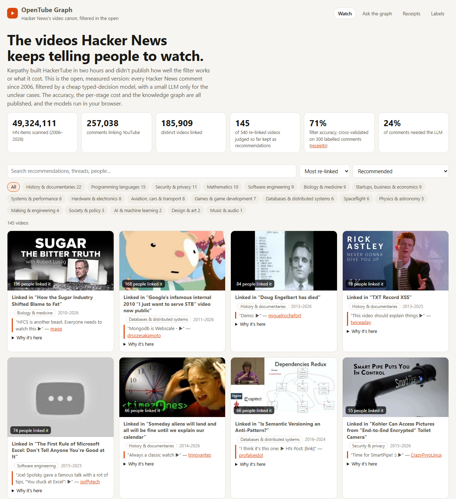
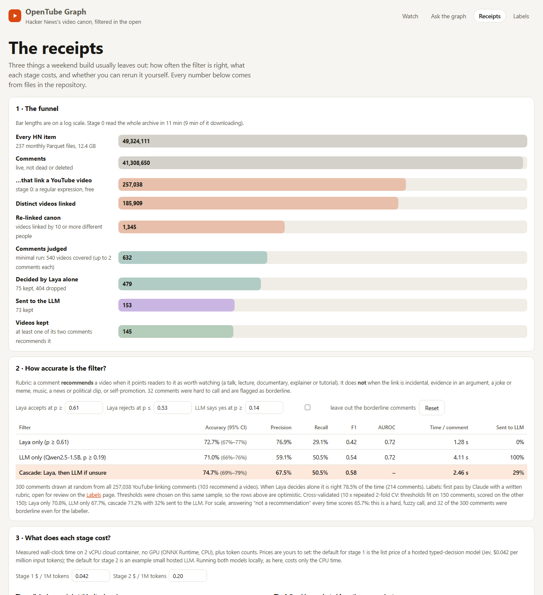
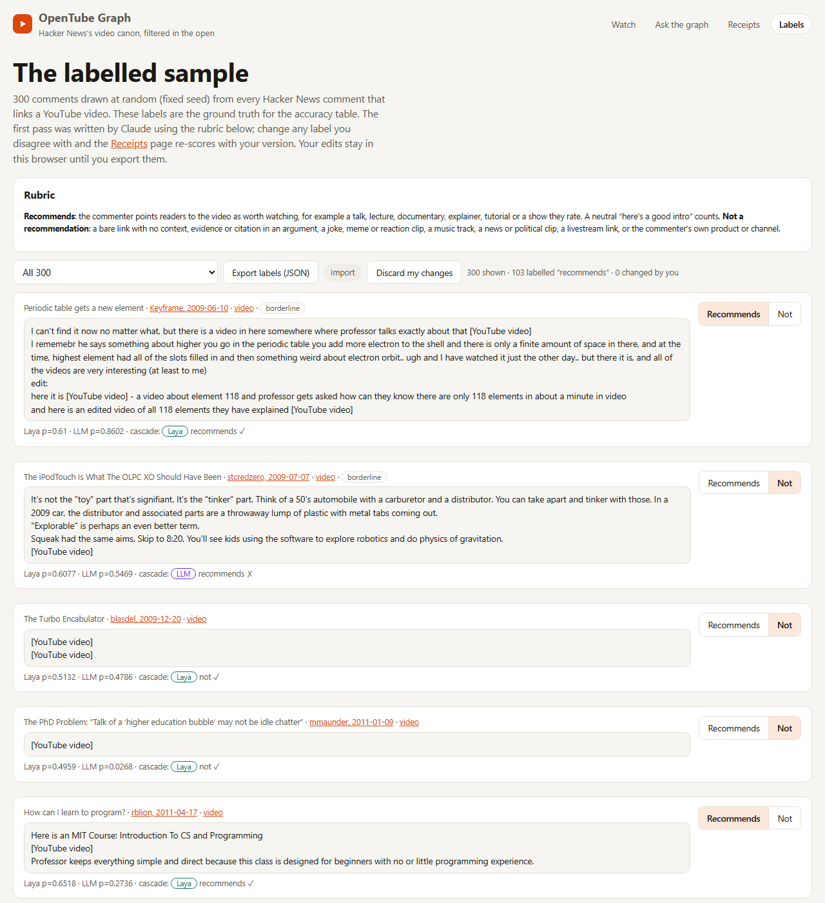
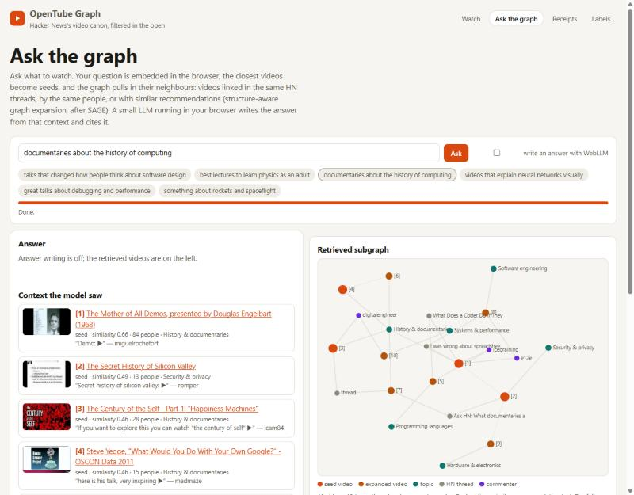

# What Hacker News Tells You to Watch, and How Sure We Are

*Inspired by Andrej Karpathy's HackerTube. Live demo: https://vishalmysore.github.io/OpenTube/*

Hacker News commenters have been sharing YouTube links since 2007. Some of those links are the best talks, lectures and documentaries on the internet: Engelbart's Mother of All Demos, Robert Lustig on sugar, Joel Spolsky on Excel. Most of them are not recommendations at all. They are a music track, a news clip, a joke, a link dropped as evidence in an argument.

Karpathy's HackerTube showed that an LLM can sort the two and turn twenty years of comments into a watch list. OpenTube does the same thing and also publishes three numbers that matter if you want to trust the list, or build something like it yourself:

1. **How often the filter is right**, measured on a labelled random sample.
2. **What each step costs**, in time and tokens.
3. **How the videos connect**, as a knowledge graph you can ask questions of, in your browser.

## The problem: "is this a recommendation?" is a fuzzy question

Take two comments that both contain a YouTube link:

- *"Here is an MIT course, Introduction to CS and Programming. The professor keeps everything simple because the class is for beginners."* This is a recommendation.
- *"[YouTube video]"*, posted alone under a thread about the Turbo Encabulator. This is not, by the rubric used here: a bare link with no context.

People disagree on the cases in between. Out of 300 random comments, 32 were hard enough to be flagged as borderline. If you hand the whole archive to an LLM and publish what comes out, you don't know how good the list is. You also pay for an LLM call on every one of 257,038 comments.

## The idea: a cheap model first, the LLM only when it is unsure

The filter is a cascade of two models.

- **Laya**, a small typed-decision model, reads each comment and gives a probability that it recommends the video. If that probability is clearly high or clearly low, Laya decides on its own.
- **Qwen2.5-1.5B-Instruct**, a small LLM, sees only the comments Laya is unsure about.

Both run on a laptop CPU with ONNX Runtime for the batch run, and in the browser for the demo. No API key is needed.

## What the site does

### Watch: the canon, filtered

Every Hacker News item from 2006 to 2026 (49 million of them) was scanned for YouTube links. That gives 185,909 distinct videos. 1,345 of them were linked by ten or more different people, and that set is the canon. Each card shows how many people linked the video, the thread it came from, the comment that recommended it, and which model made the call.

### Receipts: accuracy and cost, in the open

The Receipts page shows the funnel from 49 million items down to the kept videos, the accuracy table, and the cost of each stage at prices you can edit. The thresholds are editable too, so you can see how the trade-off between precision and recall moves.

| Filter | Accuracy (cross-validated) | Precision | Recall | Time per comment | Sent to LLM |
|---|---|---|---|---|---|
| Laya only | 70.8% | 76.9% | 29.1% | 1.28 s | 0% |
| Qwen2.5-1.5B only | 67.7% | 59.1% | 50.5% | 4.11 s | 100% |
| **Cascade** | **71.2%** | 67.5% | 50.5% | 2.46 s | about 30% |

Two results stand out:

- **The small LLM on its own is worse than Laya and about three times slower.** More model is not automatically better on a fuzzy yes/no call.
- **The cascade is the best of the three** and calls the LLM on only about a third of the comments. It keeps the LLM's recall and most of Laya's precision.

For a sense of scale, answering "not a recommendation" every time already scores 65.7%. This is a hard call, and a few points of accuracy matter.

Projected over all 257,038 comments on this CPU: about 12 days with the LLM on everything, about 6 with the cascade, about 4 with Laya alone.

### Labels: check the ground truth yourself

All 300 labelled comments are on the Labels page next to the rubric, with each model's probability shown under every comment. If you disagree with a label, change it. The Receipts page re-scores everything with your version, and you can export your labels as JSON.

### Ask the graph: questions answered from the graph

The videos are linked in a graph: two videos are connected when they were shared in the same HN thread, by the same person, or with similar recommendation text. When you ask a question such as *"documentaries about the history of computing"*:

1. The question is embedded in your browser with MiniLM (about 23 MB).
2. The closest videos become seeds: here, the Mother of All Demos, the Secret History of Silicon Valley, and The Century of the Self.
3. The graph pulls in their neighbours through shared threads, shared commenters and topics (SAGE-style expansion).
4. If your browser has WebGPU, a small LLM writes an answer that cites the videos it used.

Without WebGPU you still get the retrieved videos and the graph, as in the screenshot above.

## Where this is useful

- **Discovery.** A watch list of the talks and documentaries a technical community has kept pointing to for twenty years, grouped by topic.
- **A template for any LLM filter over a large corpus.** Comments, support tickets, reviews, or papers: put a cheap classifier in front, send only the unsure cases to the LLM, and measure both against a labelled sample before you trust the output.
- **Honest cost planning.** Time and tokens per stage, measured, with a projection for the full corpus, so you can decide before you spend.
- **Private, local Q&A.** Retrieval, graph expansion and the answer all run in the browser. Nothing you ask leaves your machine.

## Limits

- The 300 labels are a first pass by one labeller (Claude, following a written rubric). That makes a useful smoke test, not a benchmark. Corrections are welcome.
- The thresholds were chosen on the same sample, which is why the cross-validated numbers are shown next to the in-sample ones.
- The published canon run is partial: 632 of 2,683 comments, covering 540 of the 1,345 canon videos. The runner resumes where it stopped, and a GitHub Actions workflow is included to run the whole archive month by month.
- Video titles are looked up in your browser. The dataset stores only video IDs.

## Try it

- **Live demo:** https://vishalmysore.github.io/OpenTube/
- **Code and data:** https://github.com/vishalmysore/OpenTube (Apache-2.0)

Built on the open-index/hacker-news dataset (ODC-By), Laya typed-decisions, Qwen2.5-1.5B-Instruct via WebLLM, and all-MiniLM-L6-v2. Inspired by Andrej Karpathy's HackerTube; not affiliated with him, Hacker News or YouTube.
